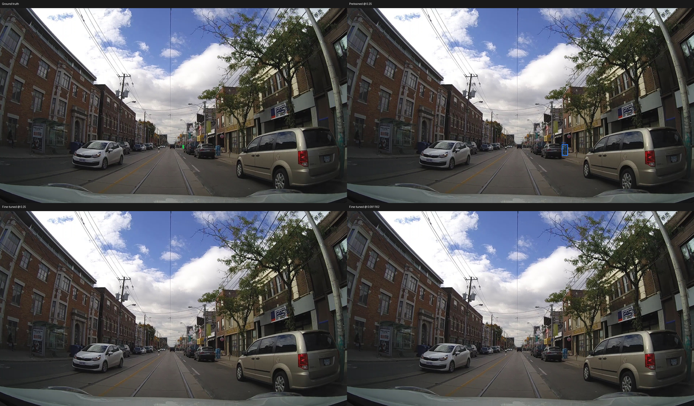
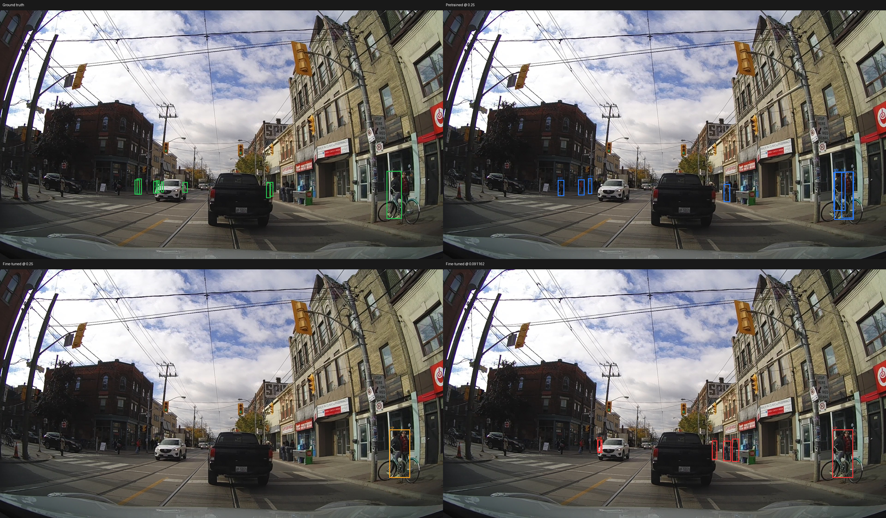
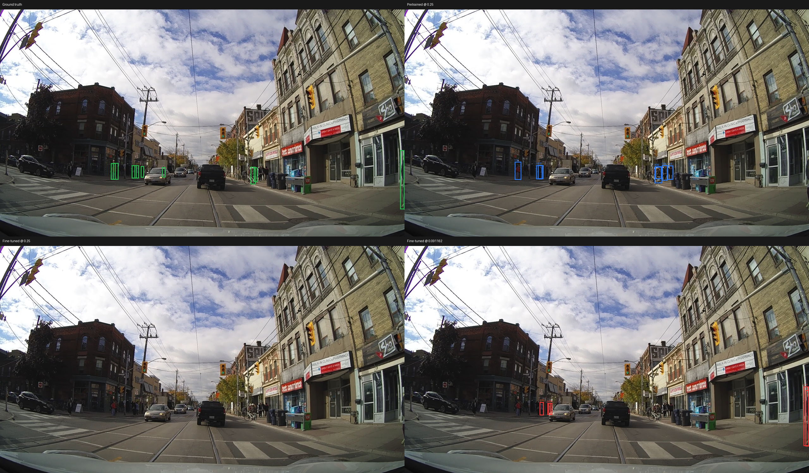

# Detector Confidence Calibration Report

**Scope:** PIE validation set06 only. The held-out test split set04 was not used.  
**Purpose:** Calibration experiment only; no detector configuration or video runner was changed.

## Result

Pretrained YOLO11s at confidence 0.25 sets the validation recall target at
**0.3974** (4,451/11,200 pedestrians).

Selected threshold: **0.091162** (precision 0.2796, recall 0.3974, F1 0.3282, TP 4,451, FP 11,470, FN 6,749, predicted boxes 15,921).

The selected point meets the target recall and improves precision by 6.23 percentage points, with 28.5% fewer false positives than the pretrained baseline at 0.25.

The selection scans every distinct stored fine-tuned confidence score from 0.05 through 0.50; it is not limited to the 0.001 reporting grid. At each score, detections at or above the score are matched in descending confidence order using Ultralytics greedy matching at IoU 0.50. The CSV includes a 0.001 grid and the exact selected threshold when it falls between grid points.

## Validation data and readiness

| Item | Value |
|---|---|
| Split | set06 validation |
| Images evaluated | 3,911 |
| Annotated pedestrian boxes | 11,200 |
| Image size | 640 |
| Inference NMS IoU / confidence floor / max detections | 0.70 / 0.001 / 1,000 |
| Batch / device | 16 / GPU 0 |
| Class restriction | class 0 (pedestrian) |
| Matching IoU | 0.50 |
| Pretrained checkpoint SHA-256 | `85a76fe86dd8afe384648546b56a7a78580c7cb7b404fc595f97969322d502d5` |
| Fine-tuned checkpoint SHA-256 | `9e1d876ff9ccc49d03f43da9dbe5bb4df71c2a7514dbaad24585e4a1f855ecfb` |
| Same image order / labels | Verified |
| Test set04 used | No |

### Environment recorded during readiness

| Component | Version / device |
|---|---|
| Python | 3.12.3 (tags/v3.12.3:f6650f9, Apr  9 2024, 14:05:25) [MSC v.1938 64 bit (AMD64)] |
| PyTorch | 2.14.1+cu126 |
| Ultralytics | 8.4.198 |
| CUDA | 12.6 (available=True) |
| GPU | NVIDIA GeForce RTX 4070 Laptop GPU |

## Operating-point comparison

| Operating point | Threshold | Precision | Recall | F1 | TP | FP | FN | Predicted |
|---|---:|---:|---:|---:|---:|---:|---:|---:|
| Pretrained baseline @ 0.25 | 0.250000 | 0.2172 | 0.3974 | 0.2809 | 4,451 | 16,038 | 6,749 | 20,489 |
| Fine-tuned @ 0.25 | 0.250000 | 0.4856 | 0.2193 | 0.3021 | 2,456 | 2,602 | 8,744 | 5,058 |
| Selected fine-tuned operating point | 0.091162 | 0.2796 | 0.3974 | 0.3282 | 4,451 | 11,470 | 6,749 | 15,921 |
| Fine-tuned highest F1 | 0.125452 | 0.3410 | 0.3437 | 0.3423 | 3,849 | 7,440 | 7,351 | 11,289 |
| Fine-tuned closest P/R parity | 0.126239 | 0.3420 | 0.3420 | 0.3420 | 3,830 | 7,370 | 7,370 | 11,200 |

### Threshold selection details

- **Primary selection:** highest precision among thresholds with recall at least 0.3974.
- **Highest F1:** 0.125452 (P=0.3410, R=0.3437, F1=0.3423).
- **Closest precision/recall parity:** 0.126239 (P=0.3420, R=0.3420); defined as minimum absolute difference between precision and recall, with ties preferring higher F1 then higher threshold.
- **Target achieved:** Yes.

## Visual verification

Each validation-only montage shows ground truth, pretrained @ 0.25, fine-tuned @ 0.25, and fine-tuned at the selected threshold.

### Small Or Distant

At least two GT boxes; median normalized box area <= set06 25th percentile (0.00037446). Image: `validation/set06/video_0005/frame_000571.jpg` (2 GT boxes).

### Partially Occluded

At least two GT boxes and >=1 PIE partial/full occlusion annotation. Image: `validation/set06/video_0004/frame_009922.jpg` (9 GT boxes).

### Crowded

At least nine GT pedestrian boxes in the frame. Image: `validation/set06/video_0004/frame_010023.jpg` (9 GT boxes).

## Artifacts

- [Threshold metrics CSV](metrics/threshold_metrics.csv): 0.001 confidence grid from 0.05 to 0.50, plus the exact selected point if needed.
- [Refined calibration JSON](metrics/refined_calibration_results.json): selected point, alternate operating points, integrity checks, and visual manifest.
- [Original raw evaluation JSON](metrics/calibration_results.json) and per-image predictions in `metrics/`.
- [Original calibration configuration](configs/calibration_config.json); [refinement configuration](configs/refined_calibration_config.json).
- Validation visual samples and [visual manifest](visuals/visual_manifest.json).

## Interpretation and limitations

This is a set06 validation calibration result, not an unbiased test estimate. The refined sweep reuses the saved per-image predictions and does not rerun inference, train, fine-tune, or modify either checkpoint. The report does not deploy the selected threshold. Review the validation visual examples and downstream behavior before considering any pipeline change; do not use set04 for threshold selection.
