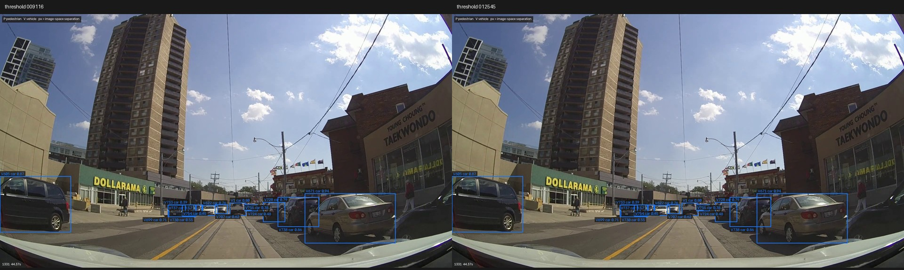
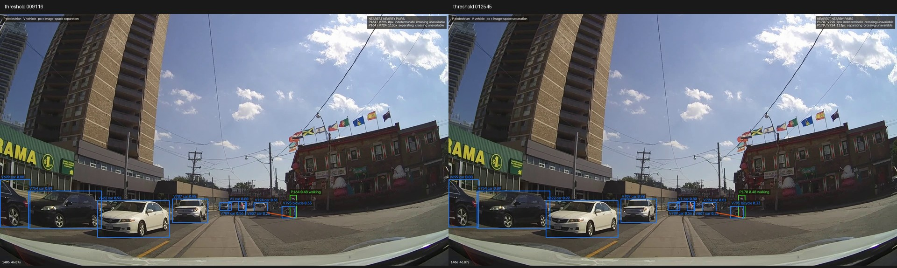
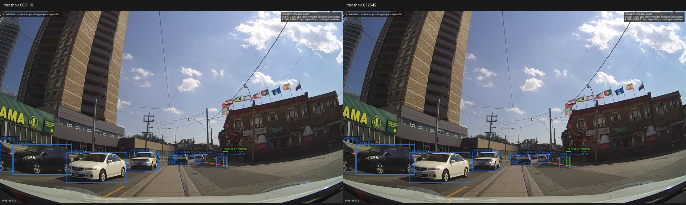

# SmartPed AI Detector Threshold A/B Tracking Evaluation

**Experiment:** Integration/demo run on PIE training footage (`set01/video_0001`), first 60 seconds only. These results are not held-out generalization evidence and were not used to select a threshold.

## Protocol and controls

- Video: `C:\Users\vlctus\OneDrive\Desktop\Pattern\project development\dataset\PIE_clips\set01\video_0001.mp4`
- Interval: first 60.0 seconds, frames 0-1799, 30.000 FPS, 1920x1080.
- Pedestrian confidence: Run A 0.0911623687; Run B 0.1254522055.
- Pedestrian checkpoint: `C:\Users\vlctus\OneDrive\Desktop\Pattern\project development\runs\detect\train-5\weights\best.pt` (SHA-256 `9e1d876ff9ccc49d03f43da9dbe5bb4df71c2a7514dbaad24585e4a1f855ecfb`).
- Vehicle checkpoint: `C:\Users\vlctus\OneDrive\Desktop\Pattern\project development\yolo11s.pt` (SHA-256 `85a76fe86dd8afe384648546b56a7a78580c7cb7b404fc595f97969322d502d5`); confidence fixed at 0.25.
- Pedestrian tracker: `C:\Users\vlctus\OneDrive\Desktop\Pattern\project development\smartped_botsort.yaml`.
- Vehicle tracker: `C:\Users\vlctus\OneDrive\Desktop\Pattern\project development\smartped_vehicle_botsort.yaml`.
- GPU: NVIDIA GeForce RTX 4070 Laptop GPU.
- Vehicle detector/tracker configuration: existing `configs/vehicle_tracking.json`; copied per-run into the runner's temporary workspace, with only video/output/model/tracker/duration/sample fields materialized and vehicle confidence retained at 0.25.
- The unchanged pedestrian BoT-SORT config has `track_low_thresh: 0.10`. Run A requests detector confidence 0.091162, but the minimum emitted tracked observation was 0.1000; scores in [0.091162, 0.10) did not appear in the tracked output. Run B's minimum observed score was 0.1266.
- Interaction analysis uses the existing configuration, including its 150-pixel nearby threshold, 15-frame maximum observation gap, and movement rules.
- Detector inference image size: 640 (existing Ultralytics default, verified from the active package configuration); no source-video resizing or frame skipping was added.
- Runs are sequential on the same host/GPU; only pedestrian confidence changes.
- Control check: vehicle detection and trajectory CSVs are byte-identical across runs, with 13,226 vehicle detections in each. See the run-integrity hashes in the JSON artifacts.
- The runner's crossing-intention integration remains present. The saved model is not tracker-feature compatible, so predictions remain unavailable rather than being inferred from incompatible features.

## Before-run findings

The existing runner already supported per-run `--model` and `--confidence`, but `--confidence` was applied to both pedestrian and vehicle inference, and `--model` was shared. To keep the vehicle side controlled, the runner now accepts optional `--vehicle-model` and `--vehicle-confidence` overrides. Defaults preserve the previous shared model/confidence behavior. No shared configuration or prior experiment output was overwritten.

## Side-by-side results

| Metric | Run A: 0.091162 | Run B: 0.125452 |
|---|---:|---:|
| Run status | success | success |
| Pedestrian tracked detection observations | 3,886 | 3,735 |
| Unique pedestrian track IDs | 69 | 74 |
| Vehicle detections (fixed vehicle side) | 13,226 | 13,226 |
| Mean detections/frame (incl. empty frames) | 2.159 | 2.075 |
| Detection count/frame p95 | 4.00 | 4.00 |
| Maximum detections/frame | 7 | 6 |
| Mean detection confidence | 0.3758 | 0.3849 |
| Median detection confidence | 0.3706 | 0.3776 |
| Track duration median (s) | 0.47 | 0.32 |
| Track duration mean (s) | 2.16 | 1.91 |
| Track duration p10 (s) | 0.03 | 0.01 |
| Track duration p90 (s) | 4.17 | 3.97 |
| Track duration min (s) | 0.00 | 0.00 |
| Track duration max (s) | 30.10 | 31.30 |
| Tracks < 1 s | 47 | 51 |
| Tracks >= 5 s | 7 | 6 |
| Missing frame slots inside track spans | 655 | 572 |
| Tracks with missing frame slots | 34 | 38 |
| Included PIE boxes matched at IoU >= 0.50 | 39 | 38 |
| Annotated identities split across predicted IDs | 1 | 1 |
| Annotation-matched identity changes (diagnostic) | 1 | 1 |
| Interaction pair observations | 22,133 | 21,275 |
| Unique pedestrian-vehicle pairs | 1,335 | 1,338 |
| Nearby observations <= 150 px | 3,252 | 3,059 |
| Unique nearby pairs | 284 | 286 |
| Invalid movement estimates | 1,547 | 1,548 |
| Runtime (s) | 253.06 | 203.30 |
| Average processing FPS | 7.11 | 8.85 |
| Mean GPU utilization (%) | 18.6 | 20.5 |
| Peak GPU memory (MiB) | 327 | 327 |

## Confidence distributions

| Statistic | Run A | Run B |
|---|---:|---:|
| Minimum | 0.1000 | 0.1266 |
| 5th percentile | 0.1608 | 0.1823 |
| 25th percentile | 0.2699 | 0.2804 |
| Median | 0.3706 | 0.3776 |
| 75th percentile | 0.4669 | 0.4714 |
| 95th percentile | 0.6175 | 0.6212 |
| Maximum | 0.8043 | 0.8043 |

### Confidence histogram

| Confidence bin | Run A | Run B |
|---|---:|---:|
| [0.0, 0.1) | 0 | 0 |
| [0.1, 0.2) | 400 | 264 |
| [0.2, 0.3) | 860 | 850 |
| [0.3, 0.4) | 993 | 990 |
| [0.4, 0.5) | 916 | 915 |
| [0.5, 0.6) | 483 | 482 |
| [0.6, 0.7) | 163 | 163 |
| [0.7, 0.8) | 70 | 70 |
| [0.8, 0.9) | 1 | 1 |
| [0.9, 1.0] | 0 | 0 |

## Observed trade-offs

- Run A yielded +151 tracked pedestrian observations and +858 interaction observations versus Run B.
- Nearby observations were 3,252 vs 3,059; unique nearby pairs were 284 vs 286. The lower threshold increased nearby observations in this clip but did not increase the unique nearby-pair count.
- Median track duration was 0.47s vs 0.32s; these are tracker outputs, not identity-accuracy measures.
- Visual samples did not reveal an obvious duplicate pedestrian box in the selected frames. The smallest-area sample showed no pedestrian track box in either run; the selected occluded and densest-available samples showed a pedestrian track in each. This small, sparse sample cannot establish overall false-positive or occlusion recall behavior.
- Both runs showed the interaction panel's explicit "crossing unavailable" state. It is readable at native video size, though text is small in reduced side-by-side stills.
- The segment has no highly crowded included annotation frame: the maximum is four pedestrians. The densest available sample is therefore not a genuinely crowded scene.
- Tracker IDs differ between independent tracker runs and should not be compared numerically across panels.
- The annotation-matched ID-change indicator is one in each run, based on only 100 included sparse pedestrian boxes (39 matched for A, 38 for B). It is not formal ID-switch accuracy.
- Runtime and FPS differ between sequential runs; this single A-then-B comparison is descriptive and does not isolate a causal threshold-performance effect.

### Run A — 0.091162

- Advantage: yielded 151 more tracked observations and 193 more nearby observations than Run B in this segment.
- Disadvantage/limitation: the configured tracker low threshold is 0.10, so this run did not emit tracked boxes in the 0.091162–0.10 score interval; added interaction observations are not necessarily useful and require review.

### Run B — 0.125452

- Advantage: yielded fewer pedestrian and interaction observations, reducing the volume for downstream review.
- Disadvantage: yielded 151 fewer tracked pedestrian observations than Run A and may miss weaker detections; the small selected-image sample does not establish whether those detections were useful.

## Control-integrity verification

| Vehicle output | Run A SHA-256 | Run B SHA-256 | Identical |
|---|---|---|---|
| `vehicle_detections.csv` | `0d3b20f4de179bd25b9a08845bee6d2479cc0abc8d5281b9d26cd9613749f273` | `0d3b20f4de179bd25b9a08845bee6d2479cc0abc8d5281b9d26cd9613749f273` | Yes |
| `vehicle_trajectories.csv` | `c44a4eb4977369b98dd5939d1bfbd4182fc0cd56fd7d00248665bc8cdff877b6` | `c44a4eb4977369b98dd5939d1bfbd4182fc0cd56fd7d00248665bc8cdff877b6` | Yes |

## Run outputs

- **threshold_009116** (`0.0911623687`): [annotated video](threshold_009116/annotated_video.mp4), [processing report](threshold_009116/PROCESSING_REPORT.md), [run metrics](threshold_009116/processing_metrics.json), [pedestrian detections per frame](threshold_009116/pedestrian_detections_per_frame.csv).
- **threshold_012545** (`0.1254522055`): [annotated video](threshold_012545/annotated_video.mp4), [processing report](threshold_012545/PROCESSING_REPORT.md), [run metrics](threshold_012545/processing_metrics.json), [pedestrian detections per frame](threshold_012545/pedestrian_detections_per_frame.csv).

## Visual inspection and interpretation

### Small Or Distant - frame 1331 (2 included PIE boxes)

Small/distant candidate: at least two annotated pedestrians and the smallest median normalized box area available in the segment.

### Occluded - frame 1406 (4 included PIE boxes)

Annotated partial/full occlusion; selected frame has the greatest occluded-box count among multi-pedestrian frames.

### Densest Available - frame 1408 (4 included PIE boxes)

Densest available annotated scene in this segment; the included labels contain at most four pedestrians per frame, so no highly crowded frame is available.

The selected images are annotated output frames at identical source timestamps, with detector boxes, tracker IDs, and interaction panel from each run. PIE labels are sparse and non-exhaustive; visually unmatched boxes cannot automatically be called false positives. Track-ID continuity observations are diagnostic only. No collision-risk or real-world risk prediction is inferred.

## Interpretation, limitations, and next step

This is a training-split integration/demo result, not held-out generalization evidence and not a threshold-selection experiment. Keep the deployed threshold unchanged pending review. The crossing-intention model remains incompatible with tracker-derived features, so integrated crossing probabilities remain unavailable. Review the full annotated videos and consider a separately specified validation-split integration run before any deployment decision.
